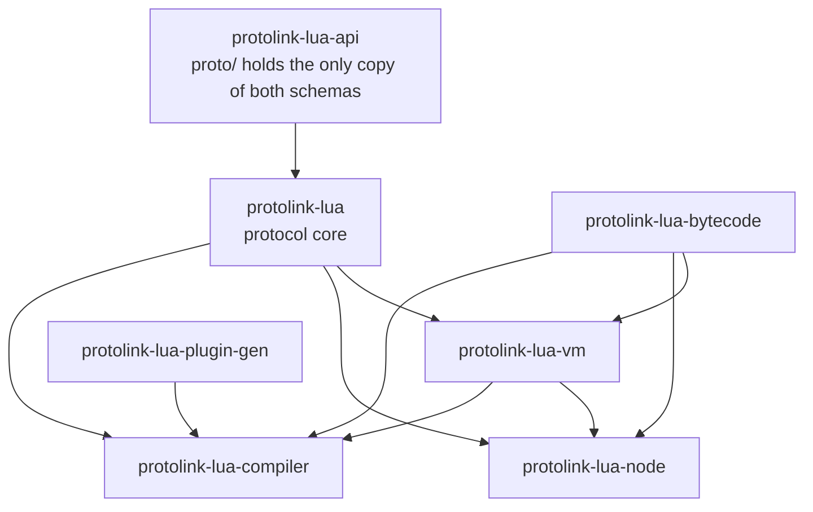

[](https://crates.io/crates/protolink)
[](https://docs.rs/protolink)
[](https://github.com/thives/protolink.rs/actions/workflows/ci.yml)

# protolink
Protolink is a gRPC framework that unifies embedded transports, framing, reliability, HTTP/2, gRPC bridging, and code generation.

It is async first, `no_std + alloc`, with options for embedded-io, blocking I/O, and tokio.

> [!WARNING]
> This crate is in early development. The API is not yet stable and may change.

> [!CAUTION]
> This crate is not yet production-ready. It has not been widely tested and may contain bugs.

## Crates

| Crate | Path | Purpose |
|---|---|---|
| `protolink` | `protolink/` | Client and server factories and drivers (async, blocking, tokio) and the COBS + ARQ link stack |
| `protolink-grpc` | `protolink-grpc/` | Sans-IO gRPC server/client (unary and streaming), routing (`Handler`, `Registry`, `MultiDispatch`), status mapping, micropb and prost codecs (features) |
| `protolink-http2` | `protolink-http2/` | Sans-IO HTTP/2 connection, built on `zerodds-http2` + `zerodds-hpack` |
| `protolink-grpc-gen` | `protolink-grpc-gen/` | Code generator: service traits, dispatchers and clients for micropb or prost messages |
| `protolink-adaptors` | `protolink-adaptors/` | Buffered ports and runners that turn a bus (I2C controller/target) or a split UART into an `embedded-io-async` stream, and a Linux serial port wrapper; see [docs/ADAPTORS.md](docs/ADAPTORS.md) and [docs/UART.md](docs/UART.md) |
| `protolink-i2c` | `protolink-i2c/` | The I2C mailbox protocol, controller transaction primitives and the target-driver trait |

```text
Application object
    ↓ implements generated traits
Generated dispatcher / service registry
    ↓ borrowed for the connection lifetime
Server driver
    ↓ owns
gRPC → HTTP/2 → optional reliable link → byte stream
```

| Layer | Crate |
|---|---|
| application | implements generated `<Service>` traits / calls `<Service>Client` |
| codegen | `protolink-grpc-gen` (service glue) + `micropb-gen` or `prost-build` (messages) |
| gRPC | `protolink-grpc` |
| HTTP/2 | `protolink-http2` |
| drivers | `protolink` (async / blocking / tokio) |
| link | `protolink::link` (COBS framing + ARQ reliability, optional) |
| transport | anything implementing `embedded-io(-async)` or tokio I/O |
| adaptors | `protolink-adaptors` (I2C controller / target as a byte stream, optional) |

## Assembling a stack

Every stack is assembled with one vocabulary: `server(io)` / `client(io)` create a factory,
`.with_*()` configures it, `.build()` constructs it without any I/O, and `.serve(&mut services)`
drives one connection (`.run()` drives an adaptor runner). Application services are independent
objects that meet the driver only at `serve`. [`docs/API.md`](docs/API.md) has the full contract,
compile-tested examples, and a migration table from the previous constructors.

### 1. Tokio server with a separate service object

```rust
use embedded_device_example::{Device, ServiceDispatch};

let listener = tokio::net::TcpListener::bind("127.0.0.1:50051").await?;
loop {
    let (stream, _) = listener.accept().await?;
    tokio::spawn(async move {
        let mut device = Device::default();                    // the application object
        let mut services = ServiceDispatch::new(&mut device);  // generated dispatcher, borrowing it
        let server = protolink::tokio::server(stream)          // the driver: a TokioTimer enforces deadlines
            .with_max_message_size(4096)
            .build();
        server.serve(&mut services).await
    });
}
```

### 2. Embedded client and server with an explicit deadline policy

Outside tokio, every factory states whether it enforces `grpc-timeout`:

```rust
// Server, on any embedded_io_async::{Read, Write} transport, with a platform `protolink::Timer`:
let server = protolink::server(io).with_deadline_timer(timer).build();
server.serve(&mut ServiceDispatch::new(&mut device)).await?;

// Client: the timeout is still sent as `grpc-timeout`, but only the server enforces it.
let transport = protolink::client(io).without_deadlines().build();
let mut client = ServiceClient::new(transport);
let reply = client.command(&request).await?;

// Blocking: a deadline clock needs a transport that bounds its reads (`blocking::ReadTimeout`).
let server = protolink::blocking::server(io).with_deadline_clock(clock).build();
```

Leaving the deadline policy out does not compile.

### 3. I2C port and runner, optional reliability, separately assembled services

```rust
use protolink_adaptors::{Binding, ControllerState, i2c_controller};

static STATE: StaticCell<ControllerState<1>> = StaticCell::new();
let Binding { port, runner } = i2c_controller(i2c, timer)  // bus adaptor; no traffic yet
    .with_address(0x42)
    .with_storage(STATE.init(ControllerState::new()))
    .build()?;
let io = protolink::link::reliable(port)                    // COBS + ARQ, only if wanted
    .with_retransmission_timer(arq_timer)
    .build();
let server = protolink::server(io).with_deadline_timer(deadline_timer).build();

// One application object behind two generated services.
let mut services = protolink::MultiDispatch::builder(&mut device)
    .with_service(ServiceMethods)
    .with_service(DiagnosticsMethods)
    .build()?;

// Nothing is spawned: poll the runner next to the server.
select(runner.run(), server.serve(&mut services)).await;
```

Independent objects are registered with `protolink::Registry::builder().with_service(..)`; both
`Registry` and `MultiDispatch` reject two services that serve the same path when built.

### 4. UART: a buffered split HAL UART, or a serial port on Linux

A split HAL UART is buffered by the same pump as the DMA path, with the adaptor vocabulary. The
runner owns both halves and is polled next to the server. Nothing is spawned.

```rust
use protolink_adaptors::{Binding, UartState, uart};

static UART: StaticCell<UartState> = StaticCell::new();
let Binding { port, runner } = uart(uart_rx, uart_tx)     // no hardware touched yet
    .with_storage(UART.init(UartState::new()))
    .build();
let io = protolink::link::reliable(port)                    // COBS + ARQ, explicitly
    .with_retransmission_timer(arq_timer)
    .build();
let server = protolink::server(io).with_deadline_timer(deadline_timer).build();
select(runner.run(), server.serve(&mut services)).await;     // runner returns only on failure
```

A UART whose driver is already cancel-safe needs no adaptor: pass it to `protolink::link::reliable`.
On Linux, a configured serial port works the same way. Opening is separate from building:

```rust
use protolink_adaptors::uart::linux::LinuxUart;

let raw = LinuxUart::open("/dev/ttyUSB0", 115_200)?;      // 8N1, raw, no flow control
let io = protolink::link::reliable(protolink::tokio::compat(raw)).build();   // ARQ timer: StdTimer
let client = protolink::client(io)
    .with_deadline_timer(protolink::tokio::TokioTimer::new())
    .build();
```

The Linux examples run the same services over `raw`, `cobs` or `reliable`, which both ends must
choose the same way: see `examples/embedded-device` and [docs/UART.md](docs/UART.md).

## Code generation

`build.rs` — one pure-Rust parse feeds both generators, so `protoc` is not needed:

```rust
let out = std::path::PathBuf::from(std::env::var("OUT_DIR").unwrap());
let fdset = out.join("service.fdset");

protolink_grpc_gen::Generator::micropb()
    .with_file_descriptor_set_path(&fdset)
    .compile_protos(&["proto/service.proto"], out.join("service_grpc.rs"))
    .unwrap();

micropb_gen::Generator::new()
    .compile_fdset_file(&fdset, out.join("service.rs"))
    .unwrap();
```

Include both outputs in the same module, then implement the generated trait.
Messages can instead come from [prost](https://docs.rs/prost) (features
`prost` on `protolink` and `protolink-grpc-gen`, `Generator::prost().compile_protos(.., &mut config)`;
see the `protolink-grpc-gen` README); the `micropb` feature stays the default.

```rust
pub mod proto {
    include!(concat!(env!("OUT_DIR"), "/service.rs"));
    include!(concat!(env!("OUT_DIR"), "/service_grpc.rs"));
}

impl proto::service::Service for MyDevice {
    fn command(&mut self, ctx: &mut protolink::CallContext<'_>, request: Command) -> Result<Reply, protolink::Status> { /* ... */ }
}
```

For each service the generator emits the trait, `<Service>Dispatch<S>` (serves one implementation,
owned or borrowed), `<Service>Methods` (for `MultiDispatch`), a `METHODS` descriptor table, and the
`<Service>Client` / `<Service>BlockingClient` wrappers that take any transport built by a client
factory.

### Streaming

For an RPC `Method`, the generated trait has:

| Shape | Trait methods |
|---|---|
| unary | `method(ctx, request) -> Result<Resp, Status>` |
| server streaming | `method(ctx, request)`, `poll_method(ctx, cx) -> Poll<Next<Resp>>`, `cancel_method(ctx)` |
| client streaming | `method(ctx, request)` per message, `poll_method(ctx, cx) -> Poll<Result<Resp, Status>>`, `cancel_method(ctx)` |
| bidirectional | `method(ctx, request)` per message, `end_method(ctx)`, `poll_method(ctx, cx) -> Poll<Next<Resp>>`, `cancel_method(ctx)` |

Servers stay sans-IO and executor-agnostic: every method gets a `CallContext` with the method path, a
`CallId` that identifies the call, its `deadline` and its [metadata](#metadata); request messages are
delivered as they arrive, and responses are pulled with `poll_*` (wake `cx` when a pending response
becomes ready). Streaming methods default to `UNIMPLEMENTED`, so adding one to a `.proto` does not
break existing implementations.

Clients return typed calls:

```rust
let mut events = client.event_subscribe(&EventSubscribe {}).await?;
while let Some(event) = events.message().await? { /* ... */ }

let mut batch = client.command_batch().await?;
batch.send(&command).await?;
let summary = batch.finish().await?;

let mut stream = client.command_stream().await?;
stream.send(&command).await?;
let reply = stream.message().await?;
stream.close_send().await?;
```

Dropping a call before it ended cancels it. Several streaming calls can be active on one client at
the same time, for example `join!`ed or, with the `std` feature, on separate tasks:

```rust
let mut first = client.command_stream().await?;
let mut second = client.command_stream().await?;
first.send(&first_command).await?;
second.send(&second_command).await?;
let (a, b) = futures::join!(first.message(), second.message());
```

The blocking server polls `Pending` streaming handlers when a read returns or times out. A transport that can
wait for input or a wake-up can implement `blocking::WakeableRead` and be served by a server built
`.with_wakeable_reads()`, which polls a handler as soon as it wakes its waker, with no read timeout.

The transport is used by one operation at a time. A pending `message()` gives way when another call
has something to write, which requires a cancel-safe transport `read` (tokio, the `link` stack and
`CobsFramed` are). The blocking client can't interrupt a read, so there you send on every call the
peer waits for before blocking on a response. Unary calls need `&mut` access to the client, so they
can't run while a streaming call exists.

See [`examples/embedded-device`](examples/embedded-device) for a complete, tested embedded-device
example, including a TCP server (`just example-server`) that can be queried with `grpcurl`.

## Deadlines

gRPC deadlines are supported: a client sends the time it is willing to wait as `grpc-timeout`, and the
call ends with `DEADLINE_EXCEEDED` when it runs out, on both sides. See
[`docs/DEADLINES.md`](docs/DEADLINES.md) for the design and the details below.

```rust
use std::time::Duration;
use protolink::CallOptions;

// One call:
let reply = client
    .command_with_options(&request, CallOptions::timeout(Duration::from_millis(500)))
    .await?;
let stream = client.command_stream_with_options(CallOptions::timeout(Duration::from_secs(30))).await?;

// Every call that doesn't set its own:
let transport = protolink::tokio::client(stream)
    .with_default_timeout(Duration::from_secs(2))
    .build();
```

Every generated client method has a `<method>_with_options` variant. The timeout covers the whole call,
not each message. A zero timeout fails at once with `DEADLINE_EXCEEDED` without sending anything.

On the server, every handler method gets a `CallContext` with the call's `deadline`; `ctx.remaining(now)`
turns it into a budget for work the handler starts. Expired streaming calls are reported to `on_cancel`.

**Time source.** The sans-IO cores never read a clock: the driver reports time with `tick(now)` and
learns when to wake with `next_deadline()`. The drivers need a clock to enforce deadlines, and without
one still *send* `grpc-timeout` (so the server enforces it) but never expire a call themselves:

| Factory | Deadline policy |
|---|---|
| `protolink::tokio::{server, client}` | nothing to do: a `TokioTimer` is supplied |
| `protolink::{server, client}` (`embedded-io-async`) | required: `.with_deadline_timer(timer)` for a `protolink::Timer`, or `.without_deadlines()` |
| `protolink::blocking::{server, client}` | required: `.with_deadline_clock(clock)` for a `protolink::Clock` and an `io` that implements `blocking::ReadTimeout`, or `.without_deadlines()`; add `.with_output_timeouts()` (`blocking::OutputTimeout`) to bound writes and flushes too |

`Clock` is `now() -> Duration` (monotonic, since any fixed point); `Timer` adds
`sleep_until(deadline) -> impl Future<Output = ()>`. On `no_std`, implement them on the platform timer:

```rust
impl protolink::Clock for EmbassyTimer {
    fn now(&self) -> Duration { Duration::from_micros(embassy_time::Instant::now().as_micros()) }
}
impl protolink::Timer for EmbassyTimer {
    fn sleep_until(&self, deadline: Duration) -> impl Future<Output = ()> {
        embassy_time::Timer::at(embassy_time::Instant::from_micros(deadline.as_micros() as u64))
    }
}
```

(`protolink::Timer` is not `protolink::link::Timer`, the ARQ retransmission timer.)

Things to know:

- **A running unary handler can't be preempted.** `Handler::call` is synchronous, so a handler that
  overruns its deadline still returns its response, which a client with its own deadline no longer waits
  for. Long-running handlers should check `ctx.remaining(now)`.
- **A cancel-safe `read` is required** whenever a timer is used, also for a unary-only server or a client
  with one call: the driver drops its pending read when a deadline is reached (the same requirement as
  streaming handlers and concurrent calls; tokio streams, `CobsFramed` and the `link` stack qualify).
- **Blocking drivers bound the read with a read timeout.** They set it to the time left before each read
  (`blocking::ReadTimeout`, or `blocking::WakeableReadTimeout`) and treat `ErrorKind::TimedOut` as an
  idle tick. Without that hook a deadline is only noticed when a read returns. `std` sockets report
  timeouts as `WouldBlock`, which `embedded-io` maps to `ErrorKind::Other`; map it to `TimedOut`.
- When a client's call expires, buffered messages are still delivered before the status, the stream is
  reset with `RST_STREAM(CANCEL)`, and the reset is written by the next operation on the client.
- A malformed `grpc-timeout` is answered with `INVALID_ARGUMENT`.

## Compression

Message compression (`grpc-encoding` / `grpc-accept-encoding`) is off by default. Turn it on with
`Compression`, through the factories' `.with_compression(..)` (or `ClientConfig` / `ServerConfig`):

```rust
use protolink::Compression;

let server = protolink::tokio::server(stream)
    .with_compression(Compression::gzip()) // needs the `miniz-oxide` feature
    .build();
```

The algorithm is behind two traits in `protolink::compression`, so a target can use what it already has:

| Trait | Implement it for | Gives you |
|---|---|---|
| `Deflate` | a raw DEFLATE library: miniz in a microcontroller's ROM, zlib, a hardware block | `Gzip<D>`, the `gzip` encoding, with header, CRC-32 and size trailer handled for you |
| `Codec` | any other algorithm (one `grpc-encoding` value) | that encoding |

`Deflate` is two methods, `deflate` and `inflate` (plus an optional `crc32` override for a ROM CRC). A
backend that can only decompress returns `CodecError::Unsupported` from `deflate` and leaves
`Compression::send` unset (no `with_send`): it then accepts compressed requests and answers uncompressed.

```rust
use protolink::Compression;
use protolink::compression::{Codec, Gzip};

// `RomMiniz` implements `Deflate` on top of the ROM routines.
static GZIP: Gzip<RomMiniz> = Gzip::new(RomMiniz);
static ACCEPT: [&dyn Codec; 1] = [&GZIP];
let compression = Compression::new(&ACCEPT).with_send(&GZIP);
```

The `miniz-oxide` feature adds the stock pure-Rust backend (`MinizOxide`, the ready-made `GZIP` and
`Compression::gzip()`); it is not enabled by default, and its compressor needs a lot of working memory.

- A server compresses a response only if the client lists the encoding in `grpc-accept-encoding`. A
  client compresses every request with `Compression::send`, so only set it for a server that supports it.
  A server answers an unsupported `grpc-encoding` with `UNIMPLEMENTED` and its `grpc-accept-encoding`.
- Messages shorter than `Compression::min_size` (64 bytes by default), and messages that do not get
  smaller, are sent uncompressed.
- `max_message_size` limits the *decompressed* size, so a small message that expands is rejected with
  `RESOURCE_EXHAUSTED` instead of being allocated. A `Codec` must honour the `limit` it is given.
- Compressed messages stay compressed while they wait to be taken, and flow-control credit is counted
  in bytes on the wire.

## Metadata

Custom metadata (the application headers and trailers of a call) is supported in both directions. See
[`docs/METADATA.md`](docs/METADATA.md) for the rules and details.

```rust
use protolink::{CallOptions, Metadata};

// Client: request metadata goes in the call options.
let mut md = Metadata::new();
md.insert("x-request-id", "req-42")?;
md.insert_bin("x-trace-bin", &[1, 2, 3])?; // `-bin` keys carry bytes, base64 on the wire
let reply = client.command_with_options(&request, CallOptions::metadata(md)).await?;
reply.message;                       // the Reply
reply.headers.get("x-request-id");   // metadata of the response headers
reply.trailers.get("x-trail");       // metadata of the response trailers

// Streaming calls: `headers()` once the server has sent them, `trailers()` once the call ended.
let mut events = client.event_subscribe(&EventSubscribe {}).await?;
while let Some(event) = events.message().await? { /* ... */ }
events.trailers();
```

On the server, the `CallContext` handed to every method is also where metadata lives:

```rust
fn command(&mut self, ctx: &mut CallContext<'_>, request: Command) -> Result<Reply, Status> {
    let id = ctx.metadata().get("x-request-id").map(str::to_owned); // request metadata
    if let (Some(id), Some(headers)) = (id, ctx.initial_metadata_mut()) {
        headers.insert("x-request-id", &id)?;                       // response headers
    }
    ctx.trailing_metadata_mut().insert("x-trail", "done")?;         // response trailers
    /* ... */
}
```

The plain generated methods (`client.command(&request)`) are unchanged and drop the response metadata;
the `<method>_with_options` variants of unary methods return a `Response<T>` with `message`, `headers` and
`trailers`. The trailers of a failed call are in `Status::metadata`.

## Compatibility profile

Supported:
- unary, server-streaming, client-streaming and bidirectional streaming RPCs
- protobuf payloads, optionally compressed with a pluggable codec (see [Compression](#compression))
- `application/grpc` (and `+proto`) content types
- `grpc-status` / `grpc-message` (percent-encoded), trailers-only error responses
- bounded message sizes (4 KiB default, configurable) and bounded buffering under HTTP/2 flow control
- deadlines: `grpc-timeout` is sent and enforced, with `DEADLINE_EXCEEDED` (see [Deadlines](#deadlines))
- custom metadata: request and response headers, trailers and binary (`-bin`) values (see [Metadata](#metadata))
- HTTP/2 h2c with preface, SETTINGS/PING acks, flow control, CONTINUATION, GOAWAY

Not supported:

- reflection, health checking, interceptors, TLS

Interoperability is tested against the `h2` crate (the HTTP/2 stack under hyper and tonic).

## Status of the reliable link

`protolink::link` composes ARQ (`arq-io-async` 0.0.3) over COBS framing (`cobs-io-async` 0.0.4).
ARQ is a poll-based state machine, so protolink supplies the adapters: `CobsTransport` (ARQ's framed
lower transport over a raw stream), `ReliableLink` (the `embedded_io_async` `Read`/`Write` interface,
with `ReliableError`) and `StdTimer`. The raw ARQ, composed-link, and embedded-device end-to-end
tests are enabled in `tests/link.rs` and `examples/embedded-device/tests/e2e.rs`. COBS framing alone
(`protolink::link::CobsFramed`) is also tested. See [docs/LINK.md](docs/LINK.md).

**Compatibility:** the ARQ wire format changed with `arq-io-async` 0.0.3 (ACK frames are 17 bytes),
so both ends of a link must run the same protolink generation. ARQ also gives up after 16
retransmission rounds without acknowledgement (about a minute for a silent peer); the link then fails
with a terminal `ReliableError(ArqError::Timeout)`.

ARQ retransmits on a timeout, so it needs a time source (the `arq_io_async::Timer` trait, re-exported
as `protolink::link::Timer`, which is not the `protolink::Timer` used for [deadlines](#deadlines)):

| Factory | Requires | Timer |
|---|---|---|
| `link::reliable(raw).with_retransmission_timer(timer).build()` | `async` | any `Timer` implementation; the `no_std` path |
| `link::reliable(raw).build()` | `async` + `std` (implied by `tokio`) | `link::StdTimer` (one reusable helper thread per link; works with any executor) |

On `no_std` targets, implement `Timer` on top of the platform timer (for example `embassy-time`) and
pass it to `with_retransmission_timer`; without `std` there is no default and `build` requires it.
`StdTimer` exists only with the `std` feature, so embedded builds do not pull it in.

### DMA UARTs

`CobsTransport` drops its raw futures after every poll (ARQ polls by hand), so the raw stream must be cancel-safe. Buffered
and interrupt-driven UARTs are; one-shot DMA drivers are not (a dropped read loses bytes, a dropped
write is aborted part-way). `protolink_adaptors::pump` is an optional lower layer for those: it owns the DMA
halves, completes every transfer, and gives the link a cancel-safe `PumpHandle`. See the module
docs for when to use it, its caveats, and a usage example.
`protolink_adaptors::uart` is the buffered UART factory over this pump: it adds the `with_storage` /
`build` vocabulary and buffer defaults, not a second buffer. The UART contract, including flush
meanings for each layer, is in [docs/UART.md](docs/UART.md).

# lua

Shared Lua crates for remote execution nodes, and the host-side compiler and generator for them. The legacy `lua` and
`lua_plugin_grpc` crates were removed on 2026-11-03.

**Status (2026-11-04): release hardening implemented and verified on the host.** The contracts, admission, ledger,
lifecycle and VM changes, the packaging of all seven crates, and the support policy are in place. Hardware integration and
publication are still open gates. See `docs/LUA-RELEASE-CONTRACTS.md` for what the crates promise, and
`docs/LUA-RELEASE-READINESS-2026-11-04.md` for the verified guarantees, the known limitations and the open gates. Neither
document is in this repository yet.

## Versions and compatibility

| Item | Value | Meaning |
| --- | --- | --- |
| Crates | `0.0.1`, all seven | Unpublished. The owner publishes them. |
| Artifact format | **4** | Canonical encoding of an artifact. Unchanged by this release. |
| Instruction ABI | **3** | The VM's instruction set and native ABI. Unchanged by this release. |
| Language profile | **1** | The Lua 5.4 subset the remote profile accepts. Unchanged by this release. |
| Protocol revision | **4** | `lua.execution.v1` semantics, negotiated in `Describe`. Raised by this release. |

**Recompilation.** This release does not change the artifact format or ABI, so an artifact compiled for the same contract is
still admitted. The node configuration changed: each node carries its contract's native operation table, so every
deployment regenerates its node configuration. A protocol revision 3 node is refused by a revision 4 caller, and the reverse, so
nodes and callers move together. See `docs/LUA-RELEASE-CONTRACTS.md`, section 6.

## Support policy

| Question | Answer | Evidence |
| --- | --- | --- |
| Minimum supported Rust | **1.89** (`rust-version` in every manifest) | Every test target compiles on 1.89. Rust 1.88 fails on `smol_str` 0.3.7, which `full_moon` depends on. CI job `msrv` |
| Edition | 2024 | All crates |
| Toolchain for development | the pinned nightly in `rust-toolchain.toml`, with `rust-src` and the riscv32 target | CI and local runs use the same file |
| Host operating system | Linux x86_64 | All tests, the package check and the consumers run here and in CI |
| Embedded target | `riscv32imac-unknown-none-elf`, compile checks only | The `no_std` crates and consumers of them. No binary runs on hardware |
| Xtensa and ESP targets | Not checked by this workspace | Not built or checked here |
| Hardware validation | **None** in this release | Allocator, stack and timing measurements on each board are open gates |
| Publication | Manual, by the owner, after the checks pass | The package check verifies every archive as a registry consumer sees it |

## Using the crates

The crates are unpublished at version `0.0.1`. After the owner publishes them, depend on them by version:

```toml
[dependencies]
protolink-lua-api = { version = "0.0.1", features = ["execution"] }   # the wire schema only
protolink-lua-node = "0.0.1"                                          # one execution node
protolink-lua-compiler = "0.0.1"                                      # host-side compiler
```

Inside this repository, depend on the paths and keep the same version requirement, so the manifests stay valid when they
are published:

```toml
protolink-lua-node = { version = "0.0.1", path = "../../protolink-lua-node" }
```

`protolink-lua-api` owns both schemas, so no other directory has to sit beside it. A consumer that uses the `plugin` feature
also needs `protolink` `=0.0.5`, which its manifest already pins.

### Publication order

A crate is published after every sibling it depends on, including its dev-dependencies, because the archive's own tests
need them:

1. `protolink-lua-api`
2. `protolink-lua`
3. `protolink-lua-bytecode`
4. `protolink-lua-plugin-gen`
5. `protolink-lua-vm`
6. `protolink-lua-compiler`
7. `protolink-lua-node`

`scripts/package-check.sh` follows this order. It stages each archive before the next crate is packaged, and it checks that
each archive contains its licences, README and schemas, and no relative path in its manifest. The generator's BSP test reads
a tree outside its crate, so it is excluded from its archive. The compiler and node tests read copies of one BSP tree under
`tests/fixtures/bsp`, and the script fails when the two copies differ.

### Working here

The Lua crates are members of the root workspace, so these commands run from the repository root and also cover the other
crates.

```sh
cargo test  --locked --workspace --features protolink-lua-api/plugin
cargo clippy --locked --workspace --all-targets --features protolink-lua-api/plugin -- -D warnings
cargo fmt --all -- --check
cargo check --locked -p protolink-lua -p protolink-lua-bytecode -p protolink-lua-vm -p protolink-lua-node --target riscv32imac-unknown-none-elf
cargo tree --locked -e normal,features -p protolink-lua-node --target riscv32imac-unknown-none-elf | grep 'feature "std"'   # must print nothing
sh scripts/package-check.sh   # vendors the locked dependencies: needs network the first time
```

The `cargo tree` audit uses `-e normal,features`: the protobuf generators are build dependencies that run on the host,
so their `std` features do not reach the target.

Where the regressions live:

| Area | Tests |
| --- | --- |
| Admission: native table, depth, in-memory limits, canonical children | `protolink-lua-bytecode/src/tests.rs` |
| Admission of a forged or mismatched reference, before any provider starts | `protolink-lua-node/src/tests/remediation.rs` |
| Ledger: exclusive reservations, stale records, final-answer table and eviction | `protolink-lua/src/ledger.rs` (`finals` module) |
| Lost commit and release replies, uncertain orphans, discard, child retention | `protolink-lua-node/src/tests/remediation.rs`, `review.rs` |
| Concatenation: golden values including floats, measured allocation, fault injection, closures, protected calls | `protolink-lua-vm/src/tests.rs`, `src/number.rs`, `tests/allocation.rs` |
| Nested-artifact verification: heap linear in size, flat stack, tree-order errors | `protolink-lua-bytecode/tests/resources.rs`, `src/tests.rs` |
| Quarantine and explicit recovery of lost children, discard during cleanup | `protolink-lua-node/src/tests/review.rs`, `remediation.rs` |

Nothing here needs `protoc`.


| Crate | Purpose | Targets |
| --- | --- | --- |
| [`protolink-lua-api`](protolink-lua-api) | Canonical `lua.execution.v1` and `lua.plugin.v1` schemas, with their generated bindings behind the `execution` and `plugin` features. | `no_std` + `alloc` |
| [`protolink-lua`](protolink-lua) | Execution protocol core: values and tuples, outcomes and dispositions, the session ledger with its bounded retirement window, pre-decode frame checks, and the poll-based child client. | `no_std` + `alloc` |
| [`protolink-lua-bytecode`](protolink-lua-bytecode) | Artifact format 4 and instruction ABI 3: canonical encoding, bounded decoding and verification, and `admit`, the one admission check that the compiler and every node run. Admission also checks every native reference against the destination's operation table. | `no_std` + `alloc` |
| [`protolink-lua-vm`](protolink-lua-vm) | The reduced VM shared by both remote nodes: bounded arena without GC, fuel, single-value native ABI, and checks before copying at the boundary. | `no_std` + `alloc` |
| [`protolink-lua-node`](protolink-lua-node) | One execution node: the lifecycle, upload, artifact store, poll-driven natives and child links, and descendant cleanup. | `no_std` + `alloc`; checked for `riscv32imac-unknown-none-elf` |
| [`protolink-lua-plugin-gen`](protolink-lua-plugin-gen) | Resolves BSP manifests and profiles, writes `bsp.lock`, and generates the bindings. | host |
| [`protolink-lua-compiler`](protolink-lua-compiler) | Host-only checker and compiler for the remote regions of a stock Lua workflow. | host |

## Layout and dependency direction



Dependencies point one way: consumers depend on the crates above, and those crates know nothing about any consumer. Anything
that needs a consumer's code lives with the consumer:

- The protobuf schemas are `protolink-lua-api/proto/lua/{execution,plugin}/v1/*.proto`. The `protolink-lua-api` build script
  reads them from inside its own directory, so no `proto/` directory beside the crates is required.

## Crate names

Six packages were renamed on 2026-11-03. The directory and the Cargo package use the hyphenated name. Rust code uses the
underscore identifier. For the last two rows the identifier did not change, because those crates keep their `[lib]` names:

| Previous directory and package | Current directory and package | Rust identifier |
|---|---|---|
| `lua_bytecode` | `protolink-lua-bytecode` | `protolink_lua_bytecode` (was `lua_bytecode`) |
| `lua_compiler` | `protolink-lua-compiler` | `protolink_lua_compiler` (was `lua_compiler`) |
| `lua_node` | `protolink-lua-node` | `protolink_lua_node` (was `lua_node`) |
| `lua_vm` | `protolink-lua-vm` | `protolink_lua_vm` (was `lua_vm`) |
| `protolink_lua` | `protolink-lua` | `protolink_lua` (unchanged) |
| `protolink_lua_plugin_gen` | `protolink-lua-plugin-gen` | `protolink_lua_plugin_gen` (unchanged) |

Dependencies follow the same mapping: `lua_vm = { path = "../lua_vm" }` becomes `protolink-lua-vm = { path = "../protolink-lua-vm" }`,
and `use lua_vm::VmLimits;` becomes `use protolink_lua_vm::VmLimits;`. `protolink-lua-api` is unchanged. The legacy `lua` and `lua_plugin_grpc`
crates were removed on 2026-11-03. The full record, with the reasons and the verification, is in `docs/LUA-CRATE-RENAME.md`.

## License

Licensed under either of

- Apache License, Version 2.0 ([LICENSE-APACHE](LICENSE-APACHE))
- MIT license ([LICENSE-MIT](LICENSE-MIT))

at your option. Each member crate carries a copy of both license files, so a published package contains them.

Licence and package-check state:

- The seven Lua crates at the repository root declare `MIT OR Apache-2.0` and each carries both licence files. `scripts/package-check.sh`
  fails when an archive is missing either licence, its README, or the schema or fixture files its own tests read, and when
  its packaged manifest still names a relative path dependency.
- The crates it packages are the ones the BSP fixtures allow: the compiler's and the node's archives carry a copy of the BSP
  tree under `tests/fixtures/bsp`, and the script fails if the two copies differ or if the fixture tree contains anything but
  TOML, Markdown and the lock file, a link, or a copyright, licence or confidentiality notice. Whether the author may license
  that material is the owner's confirmation, not something a check can decide.
