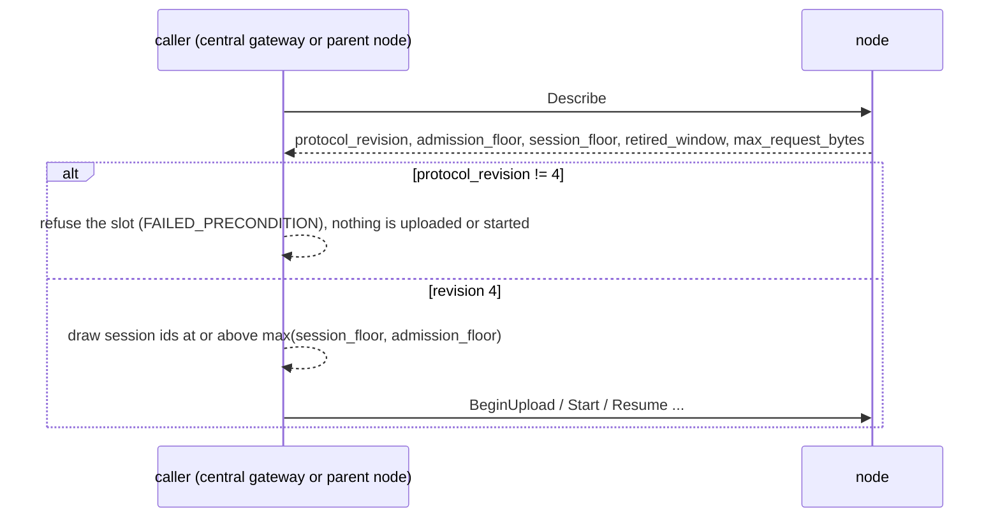

# protolink-lua-api

Canonical Protobuf schemas for the two Lua remote protocols, with their generated Rust bindings:

- `lua.execution.v1`: the distributed-execution lifecycle (artifact upload, `Start`, `Resume`, outcomes, cancellation).
- `lua.plugin.v1`: the native-plugin bridge (`Describe` and streaming `Invoke`).

These are separate products. The two packages version independently.

## Use

Enable only the protocol the consumer speaks:

```toml
[dependencies]
protolink-lua-api = { version = "0.0.1", features = ["execution"] }
```

| Feature | Adds | Rust path | Extra dependency |
| --- | --- | --- | --- |
| `execution` | `lua.execution.v1` messages. No service glue: nodes and proxies route raw bytes. | `protolink_lua_api::execution::wire::v1` | none at run time |
| `plugin` | `lua.plugin.v1` messages and the Protolink bridge service glue. | `protolink_lua_api::plugin::proto::lua_::plugin_::v1_` | `protolink` `=0.0.5` at run time; `protolink-grpc-gen` `=0.0.4` at build time |

The features are independent. A consumer that enables only `execution` never generates or compiles the plugin bridge, and
it does not depend on `protolink`. The crate is `no_std` and needs `alloc` with either feature. The `default` feature set is
empty. docs.rs builds both features, so both protocol modules are documented there.

## Layout

```text
protolink-lua-api/
├── build.rs                                  generates the enabled bindings into OUT_DIR
├── proto/lua/execution/v1/execution.proto    the only copy of lua.execution.v1
├── proto/lua/plugin/v1/plugin.proto          the only copy of lua.plugin.v1
├── src/lib.rs                                feature-gated module tree
└── tests/                                    golden wire vectors, one file per protocol
```

Generated files live in `OUT_DIR` and are not checked in. Do not edit them.

## Compatibility rules

The `.proto` files are the wire contract. A change to them is a protocol change, so:

1. Never renumber or reuse a field number or an enum value. Add new ones.
2. A change that alters the meaning of an existing message needs a new package version (`v2`). Do not edit `v1` in place.
   The two packages version independently.
3. A schema change must keep `tests/execution_wire.rs` and `tests/plugin_wire.rs` passing. If a vector is wrong, regenerate
   it with `protoc` and say why in the change.
4. Keep the schema byte-for-byte the same as the canonical copy. There is no second copy in the repository.

Recorded exception (2026-11-01): `lua.execution.v1` changed in place, before any release, to reserve session id
`u64::MAX`. A `session_floor` of `u64::MAX` now means no usable id is left. The owner accepted this as a breaking change.
Rule 2 would normally require `v2`. This exception is not a precedent. The design record is kept in the repository's
Lua release documentation, which is not part of this package.

Recorded exception (2026-11-04, revision 4): `lua.execution.v1` gained field 18 on `DescribeResponse`, and the replay
meaning of final calls changed. A final call's answer is kept for the newest `final_replay_slots` final calls, and an
identical retransmission of such a call is answered from that table. The semantics are negotiated through
`protocol_revision`, not through a new package, because the field number and every message shape are unchanged.

| Message | Field | Meaning |
| --- | --- | --- |
| `DescribeResponse` | `reserved 12` | A draft field that was never released. |
| `DescribeResponse` | `protocol_revision = 13` | Revision of the execution semantics. The current implementation advertises **4**. An unset field (0) is a node that predates them. |
| `DescribeResponse` | `admission_floor = 14` | Lowest id a new session may use. It only moves up. It is separate from `session_floor`, which keeps its meaning (first id never seen). |
| `DescribeResponse` | `retired_window = 15` | Width of the node's retirement window, in session ids. |
| `DescribeResponse` | `max_request_bytes = 16` | Largest request the node accepts, refused before it is decoded. |
| `DescribeResponse` | `session_idle_ms = 17` | Actual idle timeout of sessions on this node, in milliseconds. |
| `DescribeResponse` | `final_replay_slots = 18` | Number of final-call answers the node keeps for replay (revision 4). A final call whose answer has been evicted is refused and never runs again. |
| `QueryOutcomeResponse` | `last_mutation = 6` | Optional latest committed sequence and method-bound fingerprint from the owning live session. |
| `StatusResponse` | `last_mutation = 5` | The same receipt. An absent receipt proves nothing. |
| `ReleaseResponse` | `uncertain = 3` | Disposition captured before record disposal; trust only after revision 3 or later negotiation and `released = true`. |
| `QueryOutcomeResponse` | `uncertain = 5` | The record's disposition, whether or not an outcome is available. It never goes from true to false. |
| `StatusResponse` | `uncertain = 4` | The same disposition. |
| `CancelResponse` | `uncertain = 3` | The same disposition. A `Cancelling` answer is not proof that work stopped. |

Revision 3 fingerprints are SHA-256 of the bytes `lua.execution.v1/mutation` followed by a zero byte, the big-endian
32-bit length of the case-sensitive RPC method name, that UTF-8 method name, and the exact protobuf request bytes.
There is one execution per execution session; observation and mutation require its original epoch and session. Only a
matching receipt for a single pending operation can reconcile its sequence, once. A retired session is not a receipt.
Release discards the node record, not uncertainty or a native operation that may still be running: its caller must retain
an unresolved safety owner. A release is certain only on a reply that carries the node's own answer. A lost or malformed reply proves nothing, and a replayed answer proves what the node recorded. The protocol evidence and
its remaining integration work are recorded in the repository's Lua documentation.

Earlier revision 2 semantics that an old peer would misread, and which are therefore negotiated instead of assumed:

- A first call with a non-live session id below `admission_floor` is refused with `OUT_OF_RANGE` and never runs, even if
  the id was never used. A retired id answers `ABORTED`. Earlier nodes kept unused lower ids admissible forever.
- `Cancel` answers `Cancelling` and finishes only after descendants are cancelled, observed and released, or after the
  node's cleanup deadline, which ends uncertain.
- Artifacts are format 3 (child edges carry slot ids; natives declare result counts). A format 2 artifact is refused at
  upload.
- A request larger than `max_request_bytes` is refused with `RESOURCE_EXHAUSTED`. A request with more tuple items than
  the node allows is refused with `INVALID_ARGUMENT`. Both are refused before protobuf decoding, and neither consumes a
  sequence.

How the two sides use the revision:



Replay, stated for callers. A **replayed success** is the only way to learn the outcome of a mutating call whose reply was
lost: an identical retransmission returns the recorded answer, and it counts as activity on a live session. A final call
(`CommitArtifact` that ends its session, or a successful `Release`) is replayed while its answer is among the newest
`final_replay_slots`. After that the call is refused with `ABORTED`, and the refusal does not say whether an earlier attempt
ran. A caller that receives any error on a mutating call whose earlier reply it lost reconciles through the query path. It
does not retry. A caller that retries a mutation with a different payload on the same sequence gets `FAILED_PRECONDITION`.

A rollback is a coordinated change of host, proxy and firmware. A container restart or a new node epoch does not make an
operation whose outcome was unknown safe to repeat.

## Tests

```sh
cargo test --locked -p protolink-lua-api --features execution
cargo test --locked -p protolink-lua-api --features plugin
```

Each vector is the encoding `protoc` produces from the canonical schema for a text-format message. Decoding a vector must
give the expected values, which pins field numbers, wire types and oneof members. The re-encoded message must decode back to
an equal message. The raw bytes are not compared, because micropb encodes repeated scalars unpacked and writes oneof members
after plain fields. Both forms are valid protobuf. Regenerate a vector with:

```sh
printf '%s\n' 'epoch: 1 session_id: 2 sequence: 3' \
  | protoc --encode=lua.execution.v1.Context -I proto proto/lua/execution/v1/execution.proto | od -An -v -tx1
```

## Packaging

`build.rs` reads only `proto/` inside this crate, so a package archive contains everything it needs. Check the contents with
`cargo package --list -p protolink-lua-api`.
