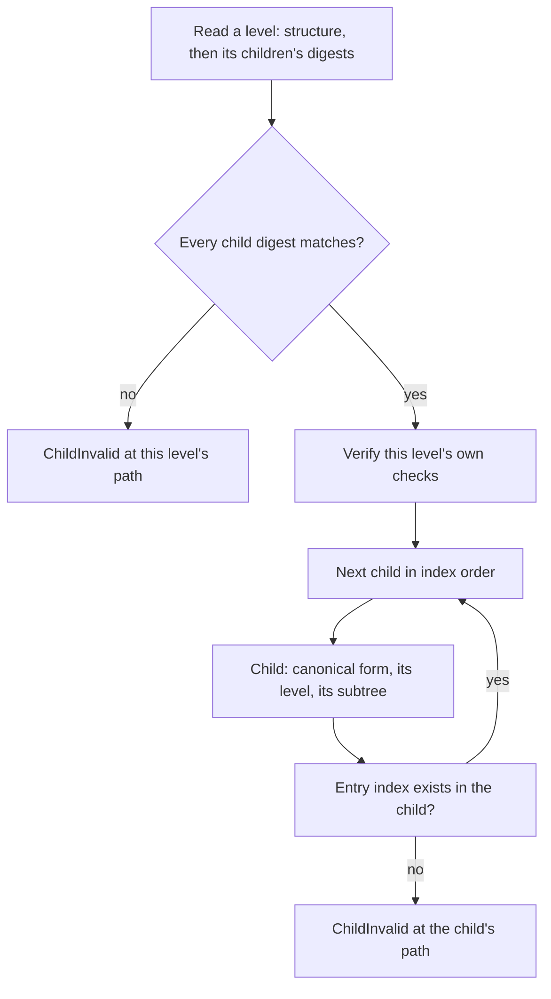

# protolink-lua-bytecode

The artifact format of the reduced remote Lua VM. A host compiler emits an artifact, a remote node admits it, and the
VM runs only verified artifacts.

- **Format 4, instruction ABI 3, language profile 1.** Decoding refuses any other version. An artifact compiled for another
  format or ABI must be recompiled; the bytes are not portable across versions.
- **Canonical encoding.** One program has one set of bytes, so one digest. Admission refuses bytes that do not re-encode
  to themselves, at the root and in every child.
- **Bounded decoding.** Every count and length is checked against its limit and the remaining input before anything is
  allocated.
- **Verification.** Structure, stack heights, jump targets, closure order, and the count, string, finite-float and depth
  bounds. `Artifact::verify` needs no contract, so it says nothing about what the code may call.
- **Admission.** `admit` runs decoding, verification and the contract digest, then requires every native reference to be
  an exact entry of the destination's operation table. Matching the table is a compatibility fact. It is not permission:
  the platform decides whether an operation may run.

## Use

```toml
[dependencies]
protolink-lua-bytecode = "0.0.1"
```

```rust
use protolink_lua_bytecode::{Limits, admit};

let limits = Limits::for_destination(16_384, 2);
// `operations` is the destination's table, generated from the same resolved contract the compiler binds against.
let artifact = admit(&uploaded_bytes, &limits, &contract_digest, &operations)?;
```

## Bounds

| Bound | Where it applies |
|---|---|
| Encoded size, `max_artifact_bytes` | Decoding, at the root and in every child |
| Constants, string bytes, natives, protos, instructions, upvalues, entries, children, captures | Decoding and `verify`, with the same limits |
| Child nesting, `max_depth` | Checked before each child is decoded, with exact arithmetic |
| Non-finite floats | Decoding and `verify` |

`Limits::for_destination` is the translation the compiler uses, so an artifact the compiler accepts is admitted by the node
it was compiled for.

## Resource use and error order of nested verification

Nested artifacts embed their children's bytes, so verification has to read every level. The traversal is **iterative** and
reads each child **in place**:

* A child is a slice of its parent's bytes. It is decoded without copying its own children, checked, and released before the
  next one is read. The verifier holds one decoded level, not one for each level above it.
* Canonical form is checked by comparing the encoder's output with the bytes as it writes them, so no second buffer is
  built (`decode_canonical` does the same).
* A work list replaces the call stack. The Rust stack does not grow with the depth.
* The heap in use is the largest decoded level, plus one `Node` for each artifact visited so far (the arena that locates a
  fault), plus the work list of pending siblings. Each is bounded by the artifact size limit, because every child occupies at
  least its own bytes, so the traversal does not grow faster than the input.



**Error shape.** `VerifyError::ChildInvalid { path, cause }` is one flat record. `path` lists the child index taken at each level
from the root to the faulty artifact, so its length is the depth of that artifact. `cause` is the fault found there, and it is
never another `ChildInvalid`. Formatting and dropping the error therefore take a bounded amount of stack at any depth. A failure
at depth 255 is formatted as `child 0.0.…0 is invalid: verification failed: …`, about 600 bytes.

**Error order.** The order of checks is fixed, and it is not strict tree order:

1. the digests of **all** children of a level are checked before any child of that level is verified;
2. then each child in index order: its canonical form, its own level, its own children in the same order, and last the entry
   index its parent names in it.

So a digest fault in a later sibling is reported before a fault inside an earlier sibling's subtree. The order is pinned by
`the_first_failure_in_tree_order_is_reported`. Decoding a level from bytes checks its child digests as it reads them; an
in-memory artifact is checked the same way, so both paths report the same first fault.

Measured on the host (x86_64, debug build, `tests/resources.rs`):

| Input | Peak heap, `decode_verified` | Peak heap, `verify` | Stack (lower bound) |
|---|---:|---:|---:|
| Chain, depth 8, 1,333 bytes | 2,424 | 1,032 | ≥ 12 KB |
| Chain, depth 32, 5,005 bytes | 8,784 | 3,720 | ≥ 12 KB |
| Chain, depth 64, 9,901 bytes | 17,264 | 7,304 | ≥ 12 KB |
| Chain, depth 128, 19,693 bytes | 34,224 | 14,472 | ≥ 12 KB |
| Chain, depth 255, 39,124 bytes | 60,936 | 21,752 | ≥ 12 KB |
| Chain, depth 255, invalid leaf (error formatted) | 60,928 | not measured | not measured |
| Wide, 16 children, 2,557 bytes | | 5,008 | ≥ 12 KB |
| Wide, 64 children, 9,901 bytes | | 19,216 | ≥ 12 KB |
| Wide, 255 children, 39,124 bytes | | 68,560 | ≥ 12 KB |
| Wide, 255 children, last one invalid (error formatted) | | 68,552 | not measured |

Before the change, the depth-255 chain peaked at 5,039,676 bytes of heap (129 times its input, growing with the square of the
depth) and reached at least 838 KB of stack, growing about 3.3 KB a level. The invalid chain peaks no higher than the valid one.

"Peak heap" is the most live heap during the call, and the figures are the sums the counting allocator reports. The stack figure
is the deepest stack position at which the call allocated, so it is a lower bound. `tests/resources.rs` asserts the linear heap
of the wide tree, the flat stack of the chain, the failure path's cost, and a 255-level artifact verified on a 48 KiB stack, and
it formats and drops a deep failure on that stack.

**What this does not show.** These are host figures from a debug build. Stack and allocator use on a target depend on its
compiler output and its allocator, and they are a hardware gate. Time is linear in the depth times the size, because each level's
children are hashed once when their parent is read. Time was not measured, on the host or on a target. No destination cap on
`max_spawn_depth` is needed for stack or heap, and none was added.

## Migration: revalidate cached artifacts

The encoding did not change (format 4, ABI 3, profile 1), but **an artifact that was stored or cached before is not
guaranteed to be admitted today.** Admission now also checks structure that earlier code let through, and every native
reference against the destination's operation table. Treat any cached artifact as unverified: run it through `admit` (or
`Artifact::decode_verified` for structure alone) with the destination's current limits and table, and recompile the ones
that are refused. Do not assume that unchanged bytes mean unchanged admission.

## Licence

Licensed under either of Apache License, Version 2.0 ([LICENSE-APACHE](LICENSE-APACHE)) or MIT license
([LICENSE-MIT](LICENSE-MIT)), at your option.
