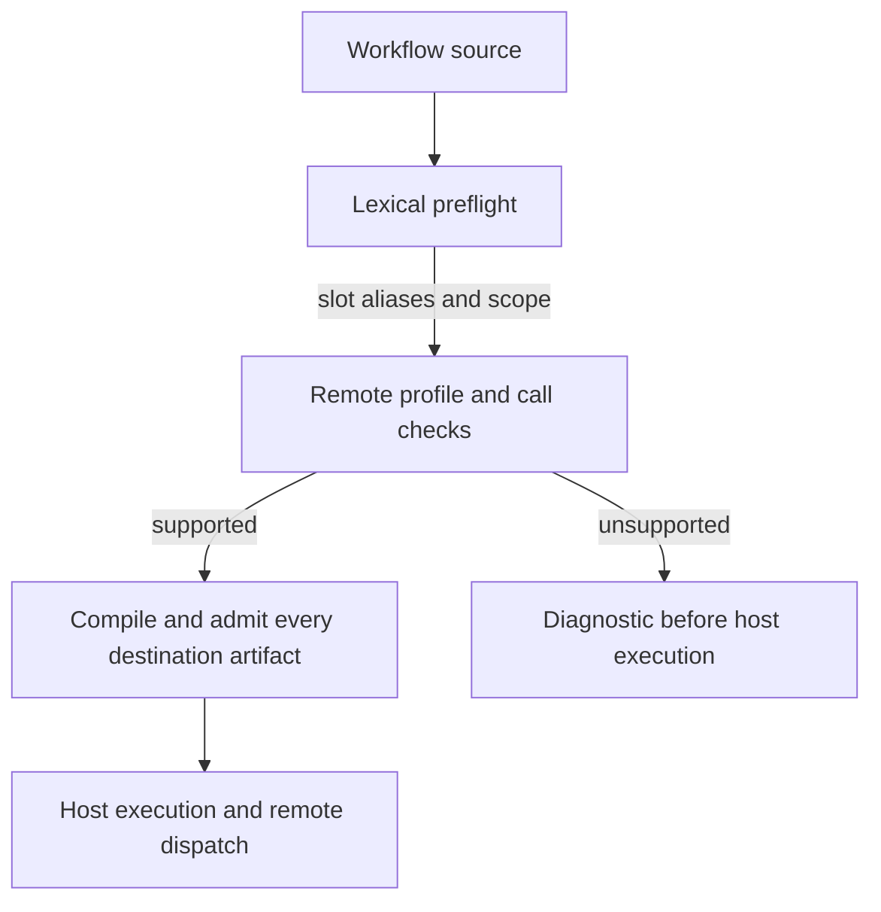
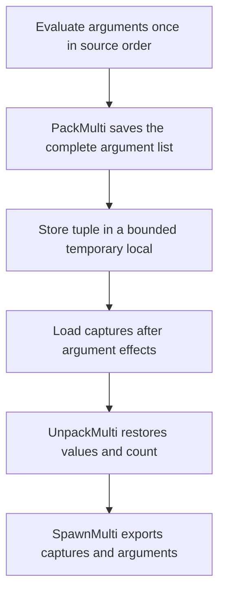

# Compiler W6 semantics and ABI 3

## Destination admission

Every artifact the compiler emits is admitted with the function a destination node runs, using that destination's limits,
contract digest and native operation table (`CheckerRules::natives`, from the same resolved contract the generator emits
into the node). A compile succeeds only when the destination would admit the artifact. A call to an operation whose
signature the artifact ABI cannot carry is a diagnostic, not a truncated reference.

The host scanner retains a `repeat` body's lexical scope through its `until` expression, including nested repeats. Both the capability scan and closure-cell scan use this lifetime. A slot alias in the condition is checked as a placement, while a locally shadowed ordinary object remains host Lua. Compilation must finish before workflow execution, so a diagnostic prevents host effects.

Remote `:await` accepts no explicit arguments, including string and table shorthand. The shared call classifier checks this before lowering, including tail and chained calls. This restriction does not apply to ordinary host objects.

## Dynamic spawn and protected calls

Lua evaluates spawn arguments left to right before the capture snapshot, with the final unparenthesized call contributing all its results. The verifier requires a dynamic-result marker to be consumed immediately. To meet both requirements, the compiler uses this sequence when the argument tail is dynamic and the child has captures:

`PackMulti` consumes a marker plus the specified fixed prefix and preserves the exact count, including zero values and trailing nils. The VM checks stack availability and admits the tuple against heap object and byte budgets before copying; its allocation is fallible. The compiler checks the temporary local and fixed-argument bounds; dynamic values are bounded by the frame stack and the exported tuple's wire limits. Like other VM heap objects, the temporary tuple remains charged for the lifetime of the machine. Dynamic spawns without captures do not need this allocation. Parenthesized final calls still contribute exactly one value.

For `pcall(factory())`, `PcallList` consumes the entire expanded list and selects the first value as callable only after the factory completes. An empty list raises the missing-argument error before a protected call is established; a present but non-callable value produces a protected failure. Argument evaluation errors remain outside the inner protected call. `pcall((factory()))` still receives exactly one value, and `pcall(f, factory())` uses the ordinary protected call with a dynamic argument tail. A statically zero-result native used as the sole argument is evaluated before the missing-argument error.

The verifier checks that both new instructions follow a marker producer immediately, are not jump targets, and have sufficient static stack height. The VM checks the dynamic count and stack bounds at runtime. Compiler tests verify destination admission for the changed spawn lowering; VM tests cover the tuple budget and stack limits, and differential tests compare result adjustment with stock Lua.

## Migration and identity

The artifact format is now **4** and the instruction ABI is **3**; the profile field remains unchanged. Both new instructions have encoded opcodes. Node descriptions advertise the format version; decoding and admission also enforce both version fields. New decoders refuse old artifacts, including nested artifacts, and old decoders refuse new artifacts. This intentionally invalidates older artifacts that might contain incorrect dynamic capture or result semantics. Compiler provenance also includes `+w6-abi3` for audit, but provenance alone is not an admission identity.

Coordinate compiler and all destination VM deployments, invalidate cached ABI 2 artifacts, and recompile workflows before starting them on the upgraded fleet. Do not mix ABI versions within a workflow's destinations or roll back without recompiling for the target ABI. Preserve the normal operational drain, cancellation and uncertainty reconciliation procedures during the transition; changing ABI does not settle in-flight physical work.
