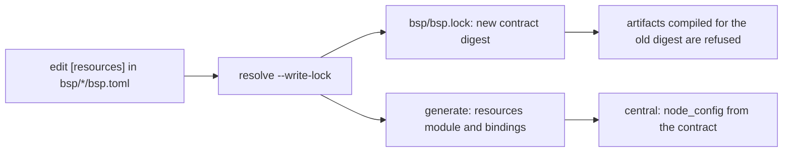

# BSP manifests

Each `bsp/<role>/bsp.toml` is a consumer manifest. It declares one Lua contract: its name and id, the privileges it declares, the contracts it imports, its child slots, and its compile-time resource envelope. The generator (`lua/protolink-lua-plugin-gen`) resolves the manifests, writes `bsp/bsp.lock`, and generates the Rust and LuaLS bindings. Nothing here is read at run time except the values the generator bakes in.

## Contracts in this BSP

| Folder | Contract name | Id | Role |
| --- | --- | --- | --- |
| `host/` | `example.fixture.host` | `1b0a8e2c-7d4f-4e6a-9c1b-5a2f3e4d6c70` | The central host. It runs the workflow and spawns one `remote` child. |
| `agent/` | `example.fixture.remote` | `2bdbdeef-600a-46de-82b5-1936195c2d11` | The node the host spawns. It spawns one `remote` child, the DUT, over its UART. Its natives are the base chip and reset modules and the OTA module, imported with `[[module_imports]]`, and its own `dut` module (boot mode, RAM writes, start, connect, `load_stub`), `storage` module (named files: create, delete, open, close, read, write, digest) and `nvs` module (key/value: get, set). See `docs/AGENT-NODE-IMPLEMENTATION.md`, `docs/DUT-STUB-IMPLEMENTATION.md` and `docs/AGENT-STORAGE-NVS-IMPLEMENTATION.md`. |
| `dut/` | `example.fixture.remote` | `78240354-a109-42a2-9b91-e0497fbd55d0` | The leaf node the agent spawns. It spawns nothing. Its surface is the `base-esp32` chip module only (`base.read`), and `lib/lua_stub` runs it on the ESP32. See `docs/DUT-STUB-IMPLEMENTATION.md`. |
| `ota/` | `esp.ota` | `8923159d-10fa-4bd7-beee-5bd457cfc5d1` | Update slots and device-side verification: `ota.booted`, `ota.selected`, `ota.target`, `ota.capacity`, `ota.write`, `ota.verify` and `ota.activate`. Slots are named by opaque identifiers. `lib/esp_bsp` implements it on the ESP. See `docs/AGENT-OTA-IMPLEMENTATION.md`. |

The agent and the DUT share a name and are told apart by id. Both are `remote` nodes, so the agent's child slot is also called `remote`. The `base-esp32*` roots are the ESP base BSP, documented in `docs/ESP-BASE-BSP-IMPLEMENTATION.md`. Its version 2.0 removes the partition module and `flash.write`. Slot selection and writes moved to the OTA contract, which is version 2.0.0, and the migration is documented in `docs/AGENT-OTA-IMPLEMENTATION.md`. Version 1.2 added the boot selection and `reset.restart`. Version 1.1 added `flash.write`, which 2.0 removes (`docs/ESP-BASE-BSP-FLASH-WRITE.md` is historical).

## Manifest sections

```toml
[contract]            # name, id, version, language and remote-data profiles, privileges
[contract.limits]     # wire limits, capture and result payload bounds, and spawn depth (see Contract limits)
[[imports]]           # another contract this one refers to, by path, id and version
[[child_execution]]   # a child slot: name, id, index, child contract, requires, delegates, per-call bounds
[resources]           # the node's compile-time resource envelope (below)
```

The language profile named by `language_profile` lives in `bsp/profiles/<name>.toml`. See
[Language profile and native ABI](#language-profile-and-native-abi).

## Resource envelope (`[resources]`)

BSP authors set these values. They are compile-time values, so each node is built with the envelope its contract declares. The generator refuses an envelope unless all of these hold:

- every value is greater than zero;
- `max_chunk_bytes` ≤ `max_artifact_bytes`;
- `max_artifacts` > `max_executions`;
- `max_answer_bytes` ≥ 72, the largest answer of a mutating call, so a replay answer can always be kept;
- `retired_window` ≥ `max_sessions`;
- `max_request_bytes` is at least the largest request the contract's wire limits and `max_chunk_bytes` allow.

The node checks the same rules again when it is constructed. The values are illustrative until measured on the target board.

| Key | Unit | Enforced where | Meaning | Memory it can hold |
| --- | --- | --- | --- | --- |
| `max_artifact_bytes` | bytes | `BeginUpload` refuses a larger declared length | Largest encoded artifact, including the children it embeds | Each open upload holds up to this many bytes |
| `max_chunk_bytes` | bytes | `PutChunk` refuses a larger chunk. The central sends chunks of the size the node advertises | Largest upload chunk | None beyond the upload itself |
| `max_uploads` | count | `BeginUpload` refuses when this many uploads are open | Uploads open at once | `max_uploads` × `max_artifact_bytes` at most |
| `max_sessions` | count | Admission refuses a new session when this many are live | Live sessions. A session is live from its first call until its final call releases it, or until it goes idle for `session_idle_ms` | `max_sessions` × `max_answer_bytes` at most, for the replay answers |
| `max_answer_bytes` | bytes | Checked at construction against the protocol's largest mutating answer (72 bytes). A session's answer space is reserved before the call mutates anything | Largest answer kept for replay | Per live session |
| `max_executions` | count | `Start` refuses when this many executions are held. A released execution no longer counts | Executions held at once | Each execution owns one VM, so up to `max_executions` VMs |
| `max_artifacts` | count | `Start` refuses an evicted artifact, and the central uploads it again. A commit evicts the least recently used artifact that no running execution uses, and refuses when none can be evicted | Distinct artifacts the node stores. Must exceed `max_executions`, so a commit can always evict one | `max_artifacts` × the decoded size of one artifact, about 1.5 to 2 times its encoded size (measured) |
| `slice_fuel` | VM instructions | The scheduler runs at most this many instructions per slice | Work per slice before the node serves other calls | None. It sets latency |
| `total_fuel` | VM instructions | The VM stops an execution after this many instructions | Instruction budget of one execution | None. It bounds runaway scripts |
| `max_frames` | call frames | The VM refuses a deeper call | Call depth of one execution | Per execution |
| `max_objects` | objects | The VM heap refuses more objects | Heap objects of one execution | Per execution |
| `max_heap_bytes` | bytes | The VM heap refuses more bytes | Heap bytes of one execution | Per execution |
| `session_idle_ms` | milliseconds | `Node::tick` abandons a session with no call for this long | Idle time before an abandoned session is discarded. A staged upload is dropped. A running execution is cancelled through the same cleanup as `Cancel`, its children first, and removed once certain. An uncertain one is kept and holds its slot. A read counts as a call | None. It bounds how long an abandoned upload or execution holds its slot |
| `retired_window` | session ids | Admission refuses a non-live id below the window's floor, and a retired id inside it | Width of the retirement window. A live session is always served, even below the floor | `ceil(retired_window / 8)` bytes of bitmap, fixed |
| `max_child_tasks` | count | A spawn past this bound raises in the parent | Child handles one execution keeps, settled ones included | `max_executions` × `max_child_tasks` handles at most |
| `call_timeout_ms` | milliseconds | Each child operation (start, resume, query, cancel, release) | Deadline of one child operation on the downstream link. A state-changing call unanswered at its deadline makes the parent uncertain; an unanswered read or `Describe` is a plain failure, because nothing ran | None. It sets latency |
| `cleanup_ms` | milliseconds | Cancellation, idle expiry, a lease and a parent's exit | Deadline of descendant cleanup. Cleanup unfinished at the deadline ends as `Failed(Cancelled)` with `uncertain` set | None. It bounds how long a record stays `Cancelling` |
| `max_request_bytes` | bytes | `Node::handle` refuses a larger request, and a pre-decode scan refuses one with too many items, before protobuf decoding | Largest encoded request | One request buffer |

### Abandoned sessions

A session whose caller stops calling is abandoned after `session_idle_ms`. The embedding must call `Node::tick` with a monotonic millisecond clock, or nothing is ever abandoned. The first tick starts the clock, so calls made before it count as made at that tick. Reads count as activity, so a caller that keeps polling an execution keeps it.

Choose `session_idle_ms` longer than the longest silence a healthy caller leaves. An execution whose parent spawns it and then runs a long local task without awaiting it is cancelled once the silence passes the timeout. Abandonment cancels the work rather than leaving it running with no one to collect its result, because a running task may still drive an actuator.

Worst-case memory for a node is at least the sum of its uploads, its replay answers, its retirement window, its stored
artifacts, its VMs, its child handles and one request:

```
uploads    = max_uploads    × max_artifact_bytes
answers    = max_sessions   × max_answer_bytes
retirement = ceil(retired_window / 8)
artifacts  = max_artifacts  × decoded size of one artifact (about 1.5 to 2 × its encoded size)
machines   = max_executions × (max_heap_bytes + frame state for max_frames frames)
children   = max_executions × max_child_tasks × (handle + one retained outcome ≤ max_result_bytes)
request    = max_request_bytes
```

Stacks, the transport's own buffers, allocator overhead and pending control calls are not in this sum; they depend on
the board and must be measured. `Node::usage` reports the live figure of each component, so a test or a board build can
record high-water marks.

The stored artifacts are paid once: executions of one artifact share its code. The decoded size was measured on the compiler's output. A 166-byte artifact decoded to 241 bytes, and an 11 KB artifact decoded to about 21 KB.

Check that sum against the board's free RAM before you commit a manifest. The generator does not know the board.

### Changing a value



1. Edit the `[resources]` table in the manifest.
2. Re-lock, from `lua/`:

   ```sh
   cargo run -q -p protolink-lua-plugin-gen --bin protolink-lua-plugin-gen -- \
     resolve --root ../bsp --profiles ../bsp/profiles --lock ../bsp/bsp.lock --write-lock \
     ../bsp/host/bsp.toml ../bsp/agent/bsp.toml ../bsp/dut/bsp.toml \
     ../bsp/base-esp32c6/bsp.toml ../bsp/base-esp32/bsp.toml ../bsp/ota/bsp.toml
   ```

   Without `--write-lock` the same command checks the lock and fails when it is stale. The lock is version 3 and records
   each profile's fingerprint. Any root can be checked on its own against the multi-root lock.
3. Regenerate the bindings with `generate --out DIR`, using the same roots and `--lock`. Each contract produces one `.rs` and one `.lua` file, named by name and id.
4. Rebuild and rerun the tests. `cargo test -p protolink-lua-plugin-gen` checks the generator, and `cargo test` in `central-management-service` checks that the central builds each node from its envelope.

The envelope is part of the contract digest. A change to any value therefore changes the digest, and an artifact compiled for the old envelope is refused at upload with "compiled for another contract". Workflows are compiled from source at run time, so the source needs no change.

## Language profile and native ABI

`bsp/profiles/lua54-bounded-v1.toml` lists the constructs the remote checker allows, and its `[native_abi]` table names
the native ABI the remote VM implements:

```toml
[native_abi]
name = "single-value-v1"
max_results = 1
```

- The generator keeps every operation's full result signature. An operation that declares more results than
  `max_results` is refused when a contract using this profile is resolved, so generated adapters never meet a
  signature the VM cannot carry. A zero-result operation pushes no value.
- The profile's **semantic fingerprint** (name, version, allowed features and ABI) is part of every contract digest
  that uses it (canonical contract format 5). Reordering or reformatting the file does not change it. Allowing or
  removing a feature, or changing the ABI, changes every dependent digest, so artifacts compiled before the change are
  refused after the re-lock.

## Child slots

Each `[[child_execution]]` has a stable slot `id`. The compiler writes that id on the child edge of the parent's
artifact (artifact format 3). The node routes a spawn by slot id through its route table, and checks the embedded
child against the slot's contract digest. Two slots may name the same child contract and still reach different
devices. A spawn on a slot with no route is refused at `Start`.

## Contract limits

`[contract.limits]` and the child slots bound what crosses a boundary. A violation is a Lua error at the call site, so `pcall` can catch it, and the host and the node enforce the same bounds. A payload is the total length of the byte strings in a tuple.

- `max_capture_bytes` on a child slot bounds the captures a parent sends with a spawn. The host raises at `remote:spawn`, and the node raises in the parent's execution. The contract's own `max_capture_bytes` bounds the captures its node accepts at `Start`.
- `max_result_bytes` on a child slot bounds the child's result. A larger result raises at `await`.
- `max_spawn_depth` is the most levels a call chain may take, counting the root as level 1. The agent's artifact embeds one child, so the agent declares 2. The compiler and the node use one translation of the envelope (`protolink_lua_bytecode::Limits::for_destination`), so a workflow nested deeper than its destination allows is a compile diagnostic, and every compiled artifact passes its recipient's admission (`protolink_lua_bytecode::admit`).

The wire limits `max_tuple_items`, `max_string_bytes` and `max_result_bytes` bound each message as well.

## Privileges

Each contract lists its `privileges`. A child slot names two lists:

- `requires`: privileges the child must declare, so that the parent can spawn it.
- `delegates`: privileges the parent passes on to the child.

The generator checks that every name in either list is declared by the child contract. It also checks the parent side: every name in `delegates` must be declared by the contract that holds the slot. The BSP needed two fixes against this rule. The host delegated `fixture.read` and the agent delegated `gpio.read`, and neither parent declared those names, so both were removed. The DUT declares `gpio.read` itself. Nothing reads `delegates` at run time, so the fix changes no behaviour. The generator records the names in the lock and in the contract digest.

This BSP keeps one spawn privilege, `remote.execute`. The host and the agent both require and delegate it. The DUT declares it because the agent spawns the DUT with it. Keeping one name means there is one thing to grant and one thing to check.

Nothing enforces these lists yet, neither at compile time nor at run time. The 2026-11-01 decision is that anyone may upload and run code, so privileges describe intent and are locked, but they do not gate anything. A deployment that needs authorization must add enforcement, and that decision belongs to the security review.

The one exception is the ESP base and OTA contracts. Each native operation there names the privileges it `requires`, and the firmware adapter (`esp_bsp`) refuses the call before it touches the chip unless the VM was granted them. `ota.write` requires `ota.write`, so a script without that grant cannot change flash. `ota.activate` requires `ota.activate`, and `reset.restart` requires `base.reset`. See `docs/AGENT-OTA-IMPLEMENTATION.md`.

## Known gaps

- The ESP base and OTA surfaces are separate roots, and no root composes them yet. A device VM that runs OTA workflows needs both, so the adapter serves both tables, but no contract imports both. This is part of the physical path that is not built yet. See `docs/AGENT-OTA-IMPLEMENTATION.md`.
- `requires` and `delegates` are checked by the generator and locked into the digest, but nothing enforces them at run time. See Privileges.
- The firmware does not consume `[resources]` yet. `protolink-lua-node` is now `no_std` and checks for the ESP32-C6 target, but it is not part of the agent or DUT image, so these values are used by the central host's in-process nodes and the host tests only. The firmware will also need a monotonic clock and a regular `Node::tick` call for `session_idle_ms`, `call_timeout_ms` and `cleanup_ms` to take effect.
- None of these values has been measured on a board. See [`docs/LUA-READINESS-REMEDIATION-IMPLEMENTATION.md`](../docs/LUA-READINESS-REMEDIATION-IMPLEMENTATION.md).
