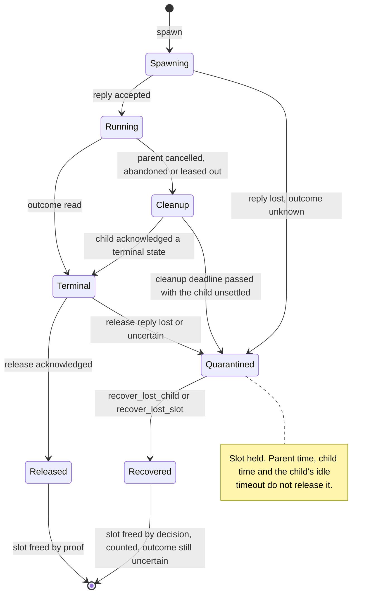

# protolink-lua-node

One execution node for `lua.execution.v1`: the session ledger, uploads and the artifact store, executions and their
lifecycle, native operations through a platform, and child links to the nodes below it. It is `no_std` with `alloc`, and
the same code runs on the host and on the remote targets. Requests are answered without running Lua. Lua runs in
`Node::poll`, one bounded round at a time, between requests.

## Use

```toml
[dependencies]
protolink-lua-node = "0.0.1"
protolink = { version = "=0.0.5", default-features = false, features = ["async", "micropb"] }
```

The embedding supplies:

- a monotonic clock, through `Node::tick`;
- the native operations, through a `Platform` (the embedding owns authorization and any hardware access);
- for a node with child slots, a `ChildClient`, such as `LinkChildren` over one `ChildLink` per slot.

`NodeConfig` carries every bound, the contract identity, and two tables:

- `operations`: the destination's native operation table. An uploaded artifact is admitted only if each native reference
  equals one entry (module, operation, argument count, result count). Generate it from the contract; do not write it
  by hand.
- `routes`: the child slots this node may spawn through.

## Guarantees

| Guarantee | How |
|---|---|
| Only verified, canonical, contract-matching artifacts run | Admission at `CommitArtifact`; the stored artifact is never replaced |
| Every native reference is declared before any provider starts | Admission compares each reference with `operations`; a refused artifact is never stored |
| A retransmitted call returns its recorded answer | The ledger replays the last call of a live session, and the last `final_replay_slots` final calls |
| A final call's answer is not rerun after eviction | An evicted final call is refused, with a status that does not claim it did not run: `Aborted` (retired) while its id is inside the retirement window, `OutOfRange` (below the admission floor) once the window moved past it |
| A call that ran always has its answer recorded | The answer is an inline `Answer` of at most 72 bytes, the storage is reserved before the call runs, and idle expiry never releases a session that holds a reservation |
| Lost child replies do not start a second child | Child operations are retransmitted unchanged and reconciled by receipt |
| A lost child is never presumed stopped | A child the node gave up on is **quarantined** and keeps its slot. Time, on either clock, does not release it. Only `Node::recover_lost_child` or `Node::recover_lost_slot` does, and both are counted |
| Uncertain outcomes stay uncertain | Disposition is never cleared by a Lua return or by recovery, and an orphan keeps its slot until `Node::discard_uncertain`, which is refused while cleanup is running |

## Replay and refusals

- A **replayed success** is the only way a caller learns the outcome of a call whose reply it lost. Any error on a
  mutating call whose earlier reply was lost means: reconcile, do not retry.
- A **final call** (`CommitArtifact` that ends its session, or a successful `Release`) keeps its answer for the newest
  `protolink_lua::ledger::FINAL_REPLAY_SLOTS` final calls. Eviction is oldest first and never reruns the call.
- A **refusal** says only that this attempt is not admitted. It never says that an earlier attempt did not run.

## Uncertain orphans

When a caller is gone while its execution's effects are unknown, the record is kept as an orphan with an uncertain outcome.
It holds its slot. The embedding may discard it with `Node::discard_uncertain(execution)` after the effects were checked
outside the node, or after the operator accepted them as unknown. The discard frees the slot and increments
`Node::discarded_uncertain()`. It does not mark the outcome as safe.

The discard is refused (`DiscardError`) while the record still holds a native (`NativeInFlight`), and **while cleanup of its
children is running** (`CleanupActive`): removing the record then would strand its child operations, its pending cancel and
its reconciliation outside any tracked state. Poll until cleanup ends. Children it could not settle are quarantined, and the
record can then be discarded without losing track of them.

## Lost children: quarantine and recovery

A child the node gave up on (a lost spawn, a lost release, or a cleanup that ran out of time) is **quarantined** by the child
client. It keeps its child slot, so no new work is admitted on the assumption that it stopped. The quarantine holds at most
`ChildSettings::max_children` entries, so it cannot grow without bound.

**Why time does not release it.** The child's advertised idle timeout is the child's claim, read on the child's clock. It
does not prove that the child's work stopped: an uninterruptible native outlives the session that started it, and the
child's clock may not have advanced at all while the parent's did. The earlier code freed the slot once the *parent's*
clock passed the timeout; that is removed.

| To free a quarantined child | Use | What the caller accepts |
|---|---|---|
| One child, after a check outside the node or an explicit operator decision | `Node::recover_lost_child(child)` | That the child may still be running and its effects may still land |
| Every child behind a slot, after the embedding reset the child node | `Node::recover_lost_slot(slot)` | That the reset really stopped the work. The node cannot check it |

`Node::lost_child_ids()` lists the quarantine with each child's slot. `Usage` reports `lost_children`, `cleanups` (executions
whose cleanup is still running), `child_operations` (client operations in progress), and `recovered_children`, a count of
children freed by decision and not by proof. Recovery changes none of this for the execution that owned the child: its record
stays uncertain, `Status` still says so, and nothing reports any outcome as certain.

After `recover_lost_slot`, the next spawn on that slot describes the child again, so the new epoch is learned before anything
is uploaded. The client refuses every operation on a quarantined child with `ChildError::Quarantined`, and the node never
sends one. A route whose children are all quarantined reserves no cleanup or heartbeat headroom, so it cannot starve another
route; a route with a live child keeps that headroom. The client contract is in
[protolink-lua](../protolink-lua/README.md#child-client-quarantine).



## Portability

`cargo check --target riscv32imac-unknown-none-elf` passes for this crate. The normal dependency tree of the crate has no
`std` feature on that target. Build scripts of the protobuf generators run on the host and are not part of the target tree.

## Licence

Licensed under either of Apache License, Version 2.0 ([LICENSE-APACHE](LICENSE-APACHE)) or MIT license
([LICENSE-MIT](LICENSE-MIT)), at your option.
