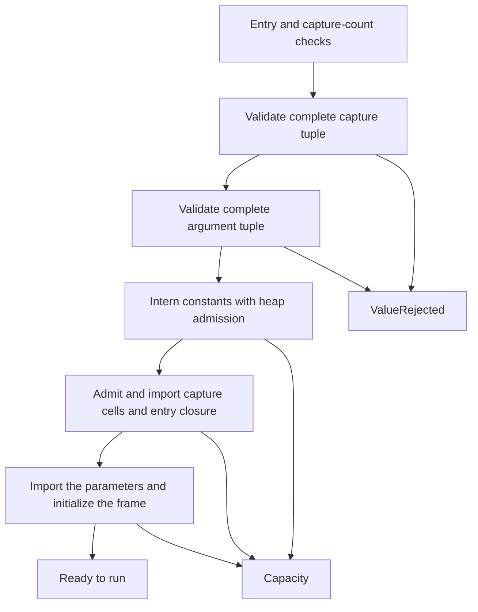
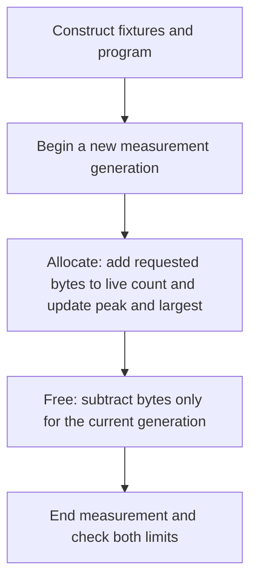

# VM input and allocation boundaries

`Machine::start` is a public boundary even when the caller already holds a verified `Program`. A verified artifact does not validate runtime captures or arguments.



The captures and arguments are checked **separately** against `VmLimits::wire`, including item count, finite floats, individual string length and checked total string bytes. Validation includes arguments beyond the entry's parameter count, although valid excess arguments are still ignored. Missing parameters remain nil. Capture-count mismatch and nonexistent entry errors take precedence over value validation. Callers that previously passed invalid or oversized unused arguments must now remove them or select appropriate wire limits; the public error enum is unchanged.

| Input | Validation before import | Heap behavior on refusal |
| --- | --- | --- |
| Startup captures and arguments | Each complete tuple, before constants or input are copied | Startup returns `ValueRejected` for wire violations and `Capacity` for heap admission failures; the unfinished machine is dropped |
| Bytecode constants | Verified with the program; each byte payload admitted before cloning | Startup returns `Capacity` |
| Native result | Single-value wire validation | A capacity failure terminates the machine |
| Awaited child result | Complete tuple validation | A capacity failure terminates the machine |
| Yield resume | Complete tuple validation | `Rejected` leaves the machine yielded and rolls back any imported objects and their charges |

Heap admission checks object count, object-ID representability and checked logical byte charges before cloning borrowed bytes, and uses fallible reservations for payloads and arena slots. Tuple and entry-closure handle buffers are admitted before construction. Charges use the existing logical arena model (16 bytes per object plus payload); they are not a measurement of allocator overhead or vector capacity. A rejected resume may retain internal vector capacity, but it does not retain objects or consume their logical heap budget.

### Guarantees and limits

The VM has no garbage collector. Its guarantees are about the **logical heap**, the arena's object count and charged bytes, and about the fuel and frames a run may use. They are not a bound on process or device memory.

| Quantity | Guarantee | Checked | Test |
| --- | --- | --- | --- |
| Logical heap bytes and objects | Never above `VmLimits::max_bytes` and `max_objects` | Before the bytes are reserved or copied | `tests/allocation.rs` |
| Concatenation | The result length is summed with checked arithmetic, admitted, then reserved fallibly; operands are copied from the heap or held inline and never cloned | Before any byte of the result is copied | `an_oversized_concatenation_is_refused_before_its_result_is_allocated`, `a_float_concatenation_over_the_budget_is_a_capacity_fault` |
| Closures | Both budgets are checked, and the arena slot is reserved, before the capture list is reserved or filled; the list is filled from the artifact in place | Before the capture list is reserved | `a_rejected_closure_allocates_no_capture_list` |
| Protected-call results and errors | The `{true, ...}` and `{false, message}` tuples are admitted against both budgets before their buffers are reserved. A failure to build or push the error ends the execution as `Capacity`; it is never reported as the error that was being caught | Before the buffer is reserved | `a_rejected_protected_result_allocates_no_result_buffer`, `a_protected_error_that_cannot_be_built_is_a_capacity_failure_not_the_caught_error` |
| Frames | `max_frames` bounds the call depth **including the entry**. `Machine::start` refuses `max_frames == 0` with `StartError::Capacity`; a call beyond the depth is `Capacity` | At start and at each call | `a_machine_that_permits_no_frames_is_refused_at_start`, `a_call_beyond_the_permitted_depth_is_a_capacity_fault` |
| Reservations on these paths | The operand stack, the frame list, locals, call-argument and result copies, tuple copies, byte copies, the constant table and the export buffers are reserved fallibly. An allocator refusal is a capacity fault that ends the execution; it does not abort | At the reservation | `refused_allocations_on_the_changed_paths_are_capacity_faults_and_never_aborts` (fails one allocation at a time over whole runs) |
| Fuel | Never above `total_fuel` across slices; protected calls cannot refill it | At each instruction | `pcall_cannot_catch_budget_exhaustion` |

**What is still infallible.** Short diagnostic texts are built with `to_vec()` and `format!`: the message of a raised error, of a refused export, and of a `Step::Failed`. Each is bounded by a fixed string, by `bounded_diagnostic`, or by the wire limits, so no program chooses its size, but an allocator refusal there aborts the process and is not a capacity fault. The same holds for allocations made by the embedding around the VM (decoding and holding artifacts, the wire tuples it returns) and for allocator overhead and vector capacity, which the logical heap does not model. The fault-injection sweep covers the programs it runs; it is evidence for those paths, not a proof for all programs. A deployment that needs every allocator refusal handled must bound its process memory outside this crate.

### Language profile notes

Concatenation accepts strings, integers and floats, in both operand orders.

* An **integer** operand has its decimal form, as in stock Lua 5.4, including `i64::MIN`.
* A **float** operand has the text stock Lua 5.4 gives it: the C library's `%.14g`, then `.0` appended when the result contains only digits and `-`. So `1.0 .. ""` is `"1.0"`, `1e15 .. ""` is `"1e+15"`, `-0.0 .. ""` is `"-0.0"` and `0.1 + 0.2 .. ""` is `"0.3"`. The implementation (`src/number.rs`) takes the 14 significant digits from Rust's exactly rounded `{:.13e}` and applies the `%g` layout; it uses `core::fmt` only, so it adds no dependency, allocates nothing and runs in `no_std`.
* Non-finite results, which arithmetic can produce at run time, print as the C library prints them: `inf`, `-inf`, `nan` and `-nan`, where a NaN's sign is its sign bit.

**Reference configuration.** The reference is stock Lua 5.4 built with its default `luaconf.h`: `lua_Number` is `double` (`LUA_FLOAT_DOUBLE`), `LUAI_NUMFFORMAT` is `"%.14g"`, the decimal point is the C locale's `'.'` because the Lua library never calls `setlocale`, and `tostringbuff` appends `.0` to integer-looking text. A Lua built with `LUA_32BITS`, a `long double` number type, a changed `LUAI_NUMFFORMAT`, or an embedding that calls `setlocale` with another decimal point is a different reference and is **not** supported. The text of `inf` and `nan` depends on the platform C library (glibc and musl print `inf`, `-inf`, `nan`, `-nan`; other libraries differ), so the differential test compares against the stock build on the same machine.

The central crate's differential tests (`central-management-service/tests/differential.rs`, which embeds Lua 5.4 through `mlua`) compare the **exact bytes** of the result for about 5,000 values in three orders (float left of a string, float right of a string, two floats): every power of ten and of two, the exponent-notation thresholds at `1e-4` and `1e14`, rounding that carries into the next power of ten, exact ties at the 15th digit, subnormals, `f64::MAX`, signed zero, run-time results including `inf` and both NaN signs, and about 2,600 generated values (random bit patterns, 1 to 17 digit decimals, and 14 to 17 digit integers with and without a half).

**Floating-point environment.** The reference's `%.14g` reads the C library's current rounding mode: glibc honours a directed
mode in `printf`, so stock Lua prints the same value differently under it. The VM's conversion is exact decimal conversion in
integer arithmetic and does not read the mode. The supported environment is therefore **round-to-nearest-even**, the default.
The differential suite checks that mode before it runs stock Lua. It also checks that the VM's text for literal values is the
same under downward, upward and toward-zero modes, where no hardware arithmetic runs. Directed modes are not a supported
reference: the suite records that stock Lua's text differs under them, and it claims nothing about that text. Hardware
arithmetic follows the mode on both sides, so the claim covers the conversion only. On a `no_std` target the VM never sets or
reads the mode, and nothing in this crate changes it. The firmware must not change it either.

**Float `//`.** `a // b` on floats is `floor(a / b)`, and `floor` keeps the sign of zero, as C's `floor` does. So
`(-0.0) // 1.0` and `0.0 // -1.0` are `-0.0`, and `(-0.0) // 1.0 .. ""` is `"-0.0"`, as in stock Lua 5.4.

### Allocation regression measurements

The counting-allocator regressions construct fixtures and programs before measuring each operation. For each attempted VM operation they measure the **peak simultaneously live requested bytes allocated during that operation** and the **largest successful individual allocation request**. These are separate limits: repeated short-lived allocations affect the cumulative total but not the peak, while several overlapping allocations can make the peak larger than any one request.



An allocation carries its measurement generation until it is freed. Thus freeing a pre-existing fixture, or an allocation retained from a previous measurement, cannot cancel out new live bytes. Allocations still live when the operation returns count toward the peak. The allocator's default reallocation allocates a replacement before freeing the old block, so both blocks count while they overlap. Measurements exclude allocator metadata and overhead, memory allocated before the operation, and memory internal to the system allocator; they are not process-wide memory or VM logical-heap bounds. Calibration tests exercise fixture frees, sequential and overlapping allocations, alignment, zeroed allocation, reallocation, and unrelated concurrent allocations.

A mutex serializes measurements, and only allocations on the measuring thread are counted, preventing test-harness activity from skewing results. Frees of tracked allocations are recognized on any thread. The measured VM operations are synchronous; allocations on threads they might spawn in the future would not be covered. Run the targeted binary with:

```sh
cargo test -p protolink-lua-vm --test allocation -- --test-threads=1
```

Run these commands from the `lua` workspace; `cargo test -p protolink-lua-vm` also runs the regressions along with the rest of the crate tests.
