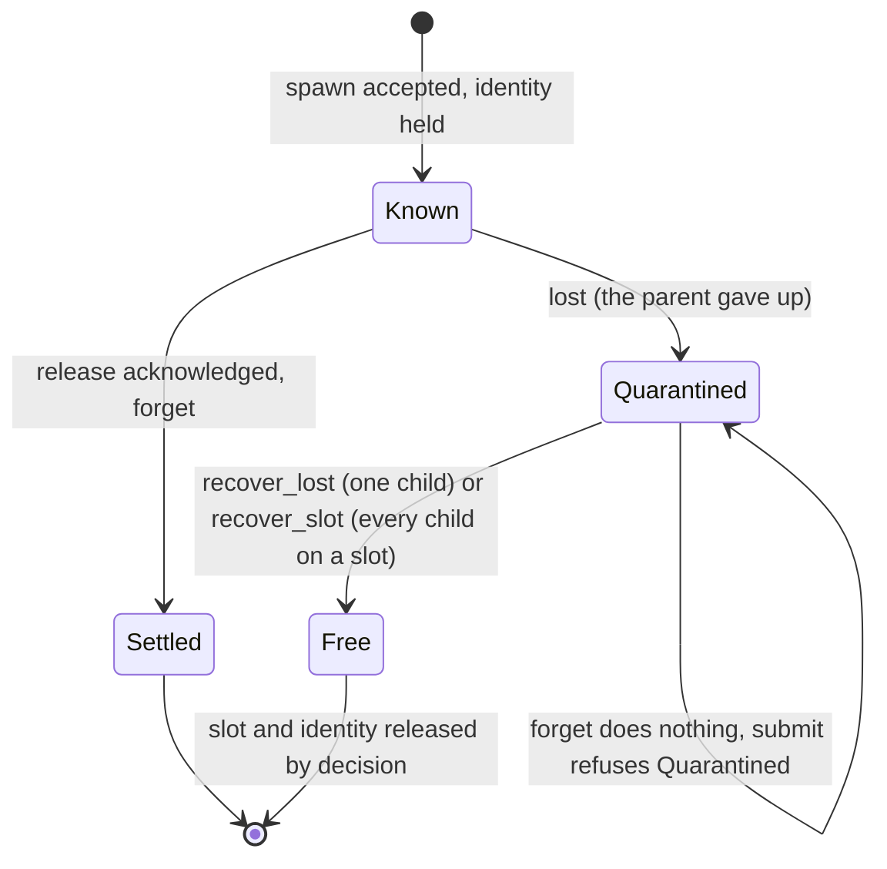

# protolink-lua

Host and node side of `lua.execution.v1`, without a Lua VM. The crate provides:

| Module | What it does |
| --- | --- |
| `value` | Remote-data v1 tuples. A tuple keeps its arity, and nil is an ordinary value. |
| `ledger` | Admission of calls per session: sequence order, replay, conflict, capacity, release and idle expiry. |
| `flow` | The caller's side of a session: which sequence the next mutating call carries. |
| `lifecycle` | The execution record: resume turns, outcomes and failures. |
| `child` | `ChildClient`, the interface a node uses to call a child slot, and the operations it carries. |
| `codec` | Protobuf encode, and decode that returns `DecodeFailed` on malformed bytes. |
| `testing` (feature) | A scripted child client for tests of consumers. |

The wire messages are re-exported as `protolink_lua::wire::v1` from `protolink-lua-api`.

## Use

```toml
[dependencies]
protolink-lua = "0.0.1"
```

The crate is `no_std` and needs `alloc`. It does not depend on a transport: a node or a proxy routes the raw bytes.

## Bounds and their limits

- `Tuple::from_wire` checks the item count, each kind, finite floats, each string, and the total of all strings before it
  copies anything. It applies the same rules as `Tuple::new`.
- It does not bound the size of the frame that carried the tuple. Protobuf decoding has already allocated that data when
  `from_wire` runs, so the embedding must cap frames before it decodes them.

## Reserved session id

`u64::MAX` (`RESERVED_SESSION_ID`) is reserved. It is never a session. A call that carries it is refused with
`Admission::Reserved`, and the ledger never records it. So the highest recorded id is at most `u64::MAX - 1`.

`Ledger::session_floor` is the first id the ledger has never recorded. When it equals `RESERVED_SESSION_ID`, no usable id
is left and no new session can start. Live sessions and unused lower ids are still served. A sequence that has reached
the top answers only a replay or a conflict, and any other call is refused with `Admission::SequenceExhausted`.

This meaning was adopted on 2026-11-01 as a breaking change to `lua.execution.v1`, as recorded in the API crate's README.

The ledger never wraps. Its arithmetic is checked, and the tests run in debug and release builds.

## Replay and final answers

A session holds at most one outstanding reservation. A second call on it is refused with `Admission::InFlight` until the
first is recorded or abandoned. A reservation carries a ticket that the session stores, so a stale reservation, one whose
session was released in the meantime, can neither overwrite a newer record nor recreate the session. `Ledger::record` and
`Ledger::finish` return `false` for a stale reservation and change nothing.

A call that ends its session (a final call) is finished with `Ledger::finish`. Its answer moves into a table of
`FINAL_REPLAY_SLOTS` (8) entries, which evicts the oldest first. An identical retransmission of a final call gets its
answer back while the entry is there. After eviction the call is refused and never runs again. Eviction is by count, so the
bound holds whatever the clock does.

An identical retransmission of a live session's last call is also answered from the ledger, and `Ledger::touch` counts it
as activity, so a caller that keeps retrying keeps its session alive.

### Which refusal a call on an ended session gets

A call on an id that is not live is refused in one of two ways, depending on how much the ledger still remembers. Neither
runs the call, and neither says whether an earlier attempt ran.

| The id is | Result |
|---|---|
| in the final-answer table, same sequence and payload | the recorded answer is replayed |
| in the final-answer table, same sequence, other payload | `Admission::Conflict` |
| in the final-answer table, other sequence | `Admission::Retired` |
| retired inside the window (its bit is set) | `Admission::Retired` |
| below the admission floor and not live | `Admission::BelowWindow { floor }` |

So an evicted final call is `Retired` while its id is still inside the window, and `BelowWindow` once a later session has
moved the window past it. The node maps them to `Aborted` and `OutOfRange`. A caller reconciles through a read in both
cases. It does not retry.

```mermaid
stateDiagram-v2
    [*] --> Reserved: reserve (slot and answer storage taken, activity stamped)
    Reserved --> Live: record (answer stored, activity stamped)
    Reserved --> [*]: abandon (a session it opened is removed; its id stays unused)
    Reserved --> FinalReplay: finish (answer filed, id retired)
    Live --> Reserved: reserve the next sequence
    Live --> Retired: tick finds it idle, or release
    Reserved --> Reserved: tick skips it, an active reservation is never expired
    FinalReplay --> Retired: evicted by count, oldest first
    Retired --> BelowFloor: a later session moves the window past the id
    Retired --> [*]: refused, never run
    BelowFloor --> [*]: refused, never run
    note right of Reserved
        A call that is running can always record its
        answer. The ledger cannot see a dropped
        reservation; reservations() counts them and
        release(id) ends the session.
    end note
```



### Reservations, activity and idle expiry

`Ledger::reserve` takes the session slot and the answer storage **before** the call changes any state. It stamps the session
with the clock. `Ledger::record` and `Ledger::finish` stamp it again. `Ledger::abandon` gives the reservation back and does
not stamp: a refused call counts as activity at the moment it was reserved, no more. **`Ledger::tick` never releases a
session that holds a reservation**, so a call that is running when the clock passes the idle timeout can still record its
answer, and a final call can still file its answer for replay. A reservation that its holder drops without completing pins
its slot; `Ledger::reservations` counts them and `Ledger::release` ends such a session. The node holds every reservation
within one call and cannot leave one behind.

### The answer bound

An answer is an `Answer`: at most `MAX_MUTATION_ANSWER_BYTES` (72) bytes, held inline. It can be built only by
`Answer::encode`, which accepts the six mutating responses whose encoded size the schema bounds (a response type that is too
large fails to **compile**), or by `Answer::commit`, which takes a 32-byte digest. So an oversized answer cannot exist,
nothing is rejected after an effect ran, and `record` copies into storage that `reserve` allocated before the effect and
never allocates. `Ledger::new` refuses a storage bound below 72 bytes.

`Answer::commit` allocates nothing either. It writes `CommitArtifactResponse` field by field from the borrowed digest, after
the artifact is stored, and a test checks those bytes against the generated encoding at every varint width. The node's reply
is a copy of the answer, so it reserves its storage before the call runs (`MAX_MUTATION_ANSWER_BYTES`); a failure to reserve
refuses the call while nothing has changed. `tests/allocation.rs` refuses every allocation on a thread and shows that
building and recording a commit answer still succeeds.

### Reservation ownership

Each `Ledger` takes an identity when it is created, and every `Reservation` names the ledger that issued it. Tickets restart
at 1 in every ledger, so two ledgers can hand out the same session and ticket. A reservation from another ledger is refused
by `record` and `finish` (they return `false` and change nothing) and ignored by `abandon`. A foreign reservation that
`record` consumes leaves its **own** session reserved, counted by that ledger's `reservations()`, until its owner ends the
session with `release`. The identity is a process-wide counter, which wraps after `usize::MAX` ledgers; a node creates one
ledger.

## Child client quarantine

`ChildClient` is the parent's view of its children, and quarantine is part of that contract. Its quarantine methods have no
default, so a client without them does not compile (a `compile_fail` doctest checks this).



| Operation on a quarantined child | Result |
|---|---|
| `lost` | Operations in progress on the child are dropped. The child keeps its identity and its slot |
| `forget` | Does nothing. The child stays quarantined |
| `submit` of any operation | `ChildError::Quarantined`. Nothing is sent, and no operation is created |
| `recover_lost(child)` | Frees that child's slot and identity. Returns `false` when the child is not quarantined |
| `recover_slot(slot)` | Frees every quarantined child on the route, and forgets the route's description, so the next spawn describes the child again and takes its new epoch before it uploads |
| time (`liveness`, ticks) | Frees nothing. A child's idle timeout is the child's own claim |

Capacity accounting: a route holds headroom for one cleanup and one heartbeat operation only while it has a child that is not
quarantined, or while it is the route of the operation being admitted. A route whose children are all quarantined reserves
nothing, so it cannot starve another route. A quarantined child still counts against `max_children`.

`recover_lost` and `recover_slot` are explicit and counted in `Usage::recovered_children`. Recovery never certifies that the
child's effects stopped: the execution that owned the child stays uncertain.

A refusal says only that the attempt was not admitted. It does not say whether an earlier attempt of the same call ran.
The protocol revision that describes these rules is `PROTOCOL_REVISION` (4).
